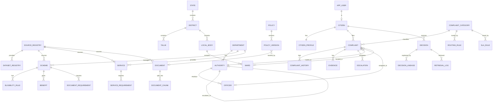

# MyGovt — Database Schema Document

The executable DDL is in [`database/schema.sql`](database/schema.sql) (parsed and syntax-checked; run it on an empty PostgreSQL 16 database with PostGIS and pgvector installed). This document explains the design.

## 1. Technology
| Component | Role |
|-----------|------|
| PostgreSQL 16 | System of record |
| PostGIS 3 | Jurisdiction, spatial queries |
| pgvector 0.7+ | Embeddings (HNSW, cosine) |
| Full-text (tsvector/GIN) + pg_trgm | Keyword and fuzzy search |
| btree_gist | Non-overlapping policy-version periods |
| Neo4j 5 | Derived knowledge graph (rebuildable) |
| Redis | Cache, rate limiting (optional) |
| MinIO | Evidence and PDF storage |

## 2. Conventions
- **Schemas** group domains: `system`, `administration`, `identity`, `schemes`, `services`, `policies`, `documents`, `complaints`, `ai`, `audit`.
- **Keys:** `uuid` for entities created at runtime (citizens, complaints, schemes, documents); `serial` for small reference/master data (district, department).
- **Time:** all `timestamptz`; stored UTC; shown in IST in the UI.
- **Geometry:** SRID 4326, `MultiPolygon` for areas, `Point` for locations; GiST index on every geometry column.
- **Soft vs hard delete:** complaints, audit, decisions are never deleted. Master data is retired by `status`.
- **Provenance:** every knowledge row carries `source_id` (and `dataset_id` where loaded from a file).
- **Naming:** `snake_case`; PK `<entity>_id`; FK same name as target PK.
- **Embedding dimension:** 1024. Changing the model means re-embedding and altering the column.
- **Vocabulary:** enumerations use `CHECK` constraints (easy to evolve in migrations vs. native enums).
- **Aadhaar and ID numbers:** never stored. `held_documents` stores document *types* only.

## 3. Entity-relationship overview



## 4. Schema-by-schema reference

### 4.1 `system`
| Table | Purpose | Key columns |
|-------|---------|-------------|
| `source_registry` | Where data comes from | `source_code`, `source_type` (official/trusted_open/synthetic), `reliability_score`, `license`, `last_checked` |
| `dataset_registry` | Each downloaded file/version | `source_id`, `checksum_sha256`, `processing_status`, quality scores |
| `quarantine_record` | Rows that failed validation | `dataset_id`, `raw_payload`, `failure_reason` |
| `feature_flag` | Toggle voice, graph, etc. | `flag_key`, `enabled` |

### 4.2 `administration`
`state → district → taluk`, `district → local_body → ward`, plus `revenue_division`, `block`.
`department` + `department_hierarchy`. `authority` (jurisdiction-bound office; `parent_authority_id` defines the **escalation chain**). `officer` (synthetic).
Function `administration.resolve_jurisdiction(lon, lat)` returns ward, local body, taluk, district.

### 4.3 `identity`
`app_user` (credentials/role) → `citizen` → `citizen_profile` (eligibility attributes) + `consent`.

### 4.4 `schemes`
`scheme` (+ `embedding`, `tsv`, `verified_at`), `eligibility_rule`, `benefit`, `document_requirement`.

**Rule model**
```
rule_group  rules in the same group are AND-ed; different groups are OR-ed
attribute   key in the eligibility-attribute registry (e.g. annual_income)
operator    = != > >= < <= IN NOT_IN BETWEEN IS_TRUE IS_FALSE
value       jsonb scalar | array | [lo, hi]
mandatory   non-mandatory rules are "preferences" and don't fail the scheme
human_readable / human_readable_ta   text shown to citizens
source_reference                     clause in the official document
```

### 4.5 `services`
`service` (e-Sevai etc.), `service_requirement`, `government_facility` (PostGIS point).

### 4.6 `policies`
`law`, `rule`, `policy`, `policy_version` (**exclusion constraint prevents overlapping effective periods**), `government_order`.

### 4.7 `documents`
`document` (typed, hashed, dated) and `document_chunk` (text, page, section, embedding, generated `tsv`).

### 4.8 `complaints`
`complaint_category`, `routing_rule` (deterministic category × jurisdiction → department/authority type), `sla_rule`, `complaint` (reference `MYG-YYYY-NNNNNN`), `complaint_history` (trigger-populated), `escalation`, `evidence`, `officer_note`. Views: `v_sla_breached`, `v_department_performance`.

### 4.9 `ai`
`conversation`, `message`, `decision`, `decision_lineage`, `retrieval_log`, `evaluation_run`.

### 4.10 `audit`
`audit_log` — append-only (update/delete blocked by trigger and by grants).

## 5. Indexing strategy
| Need | Index |
|------|-------|
| Filters (dept, category, status) | B-tree |
| Keyword search | GIN on `tsvector` |
| Fuzzy / transliteration tolerance | GIN `gin_trgm_ops` |
| Semantic search | HNSW `vector_cosine_ops` (m=16, ef_construction=64; tune `hnsw.ef_search` per query) |
| Jurisdiction | GiST on geometry |
| Overdue complaints | Partial index on `due_date` where status is open |
| Policy periods | GiST exclusion constraint |

**Tamil full-text note:** PostgreSQL has no built-in Tamil stemmer. The schema uses the `simple` configuration (tokenise, lowercase) plus trigram and vector search. Treat FTS as an exact-term booster, not the main Tamil retriever.

## 6. Integrity rules enforced in the database
1. No overlapping policy versions for a policy.
2. Complaint status limited to the state set; history rows auto-created on change.
3. Audit log immutable.
4. Complaint location/jurisdiction auto-filled from lat/lon by trigger.
5. Duplicate documents rejected by `UNIQUE(file_hash)`; duplicate dataset loads by `UNIQUE(source_id, checksum_sha256)`.
6. RLS on `complaints.complaint`: citizens see only their own rows; officer-level roles see all rows the *application layer* then scopes by authority.
7. The AI role (`mygovt_ai_readonly`) has `SELECT` only on knowledge schemas.

> Authority-level scoping (an officer sees only their jurisdiction) is enforced in the service layer with a tested query filter; RLS handles citizen isolation. Adding an RLS policy keyed on `app.authority_id` is a good hardening step if time permits.

## 7. Row-level security usage
The API sets per-request session variables inside the transaction:
```sql
SET LOCAL app.role = 'citizen';
SET LOCAL app.citizen_id = '<uuid>';
```
Use a connection-pool mode that preserves `SET LOCAL` semantics (transaction-scoped).

## 8. Key queries

**8.1 Jurisdiction from coordinates**
```sql
SELECT * FROM administration.resolve_jurisdiction(76.9558, 11.0168);  -- lon, lat
```

**8.2 Current policy version on a date**
```sql
SELECT pv.*
FROM policies.policy_version pv
WHERE pv.policy_id = :policy_id
  AND pv.effective_from <= :on_date
  AND (pv.effective_to IS NULL OR pv.effective_to > :on_date);
```

**8.3 Hybrid candidate retrieval over chunks (hard filters first)**
```sql
WITH q AS (SELECT websearch_to_tsquery('simple', :q_text) AS tsq, :q_vec::vector AS qv)
SELECT c.chunk_id, d.document_id, d.title, d.source_id,
       ts_rank_cd(c.tsv, q.tsq)             AS kw,
       1 - (c.embedding <=> q.qv)           AS sem
FROM documents.document_chunk c
JOIN documents.document d USING (document_id)
CROSS JOIN q
WHERE d.status = 'active'
  AND (d.effective_date IS NULL OR d.effective_date <= :on_date)
  AND (d.expiry_date    IS NULL OR d.expiry_date    >  :on_date)
  AND (d.jurisdiction_level = 'state' OR d.jurisdiction_id = :district_id)
ORDER BY c.embedding <=> q.qv
LIMIT 50;
```
Python then normalises scores, adds graph and reliability/freshness terms, re-ranks and passes the top-k through the trust layer.

**8.4 Candidate schemes for a citizen (SQL pre-filter, rules engine decides)**
```sql
SELECT s.*
FROM schemes.scheme s
WHERE s.status = 'active'
  AND (s.effective_from IS NULL OR s.effective_from <= CURRENT_DATE)
  AND (s.effective_to   IS NULL OR s.effective_to   >= CURRENT_DATE)
  AND (s.scheme_level = 'central' OR s.state_id = :state_id);
```

**8.5 Overdue complaints needing escalation**
```sql
SELECT c.complaint_id
FROM complaints.complaint c
WHERE c.status IN ('assigned','in_progress','submitted','classified')
  AND c.escalation_due_at < now()
  AND NOT EXISTS (SELECT 1 FROM complaints.escalation e
                  WHERE e.complaint_id = c.complaint_id AND e.status = 'open');
```

**8.6 Complaint timeline**
```sql
SELECT changed_at, old_status, new_status, remarks
FROM complaints.complaint_history
WHERE complaint_id = :id ORDER BY changed_at;
```

## 9. Seed data and examples

**Eligibility rule example (income ≤ ₹2,00,000, group 1)**
```sql
INSERT INTO schemes.eligibility_rule
(scheme_id, rule_group, attribute, operator, value, unit, human_readable, source_reference)
VALUES (:scheme_id, 1, 'annual_income', '<=', '200000', 'INR',
        'Annual family income must not exceed ₹2,00,000', 'Para 3(b), scheme guidelines');
```
(Illustrative only — real thresholds must come from the official scheme document.)

**Routing rule example**
```sql
INSERT INTO complaints.routing_rule (category_id, jurisdiction_level, local_body_type, department_id, authority_type)
VALUES (:street_light_cat, 'local_body', 'corporation', :municipal_dept, 'municipal');
```

## 10. Migrations
- Tooling: Alembic. Baseline migration = `schema.sql`; later changes are incremental, reversible migrations.
- CI check: apply all migrations on an empty DB, run `pg_dump -s`, diff against the committed snapshot.
- Never edit an applied migration; add a new one.

## 11. Backup and recovery (prototype)
- Nightly `pg_dump -Fc`; keep 7 copies.
- Recreate Neo4j from PostgreSQL (`make graph-rebuild`), recreate embeddings from `document_chunk.content` if lost.

## 12. Known design trade-offs
| Decision | Trade-off |
|----------|-----------|
| Embeddings in the same table as content | Simple joins and filters; reindex cost when the model changes |
| `jsonb` rule values | Flexible; requires validation in code against the attribute registry (the registry is mandatory) |
| Neo4j as projection | Extra service; justified by multi-hop traversal and explainability demo, but PostgreSQL remains authoritative |
| RLS + service-layer scoping | Defence in depth; officer jurisdiction scoping remains in code |
| `simple` FTS config | Works for Tamil and English tokens; no stemming |
