# MyGovt — Flow Document

All diagrams are Mermaid (render in GitHub, VS Code with a Mermaid extension, or mermaid.live).
Thresholds shown (0.60, 0.70) are configuration defaults, not fixed constants.

---

## 1. System context

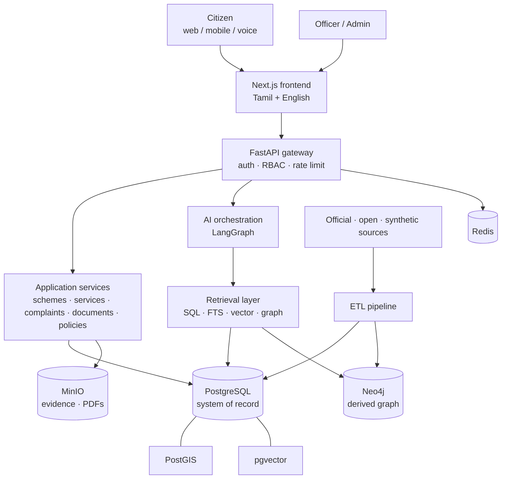

## 2. Core principle: answer pipeline

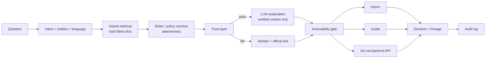

## 3. "Ask MyGovt" detailed sequence

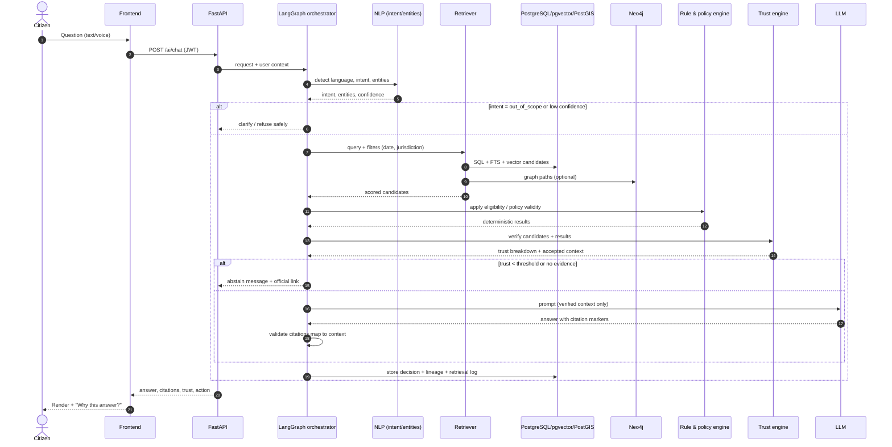

## 4. Intent routing

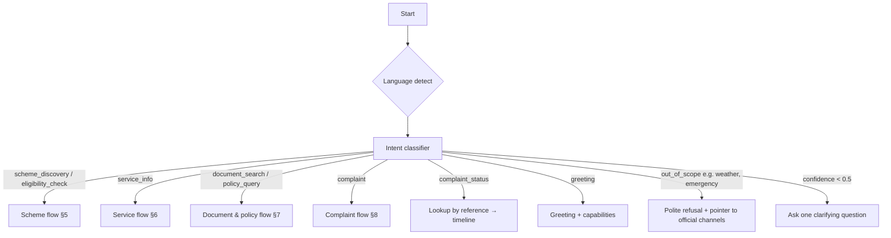

## 5. Scheme discovery and eligibility

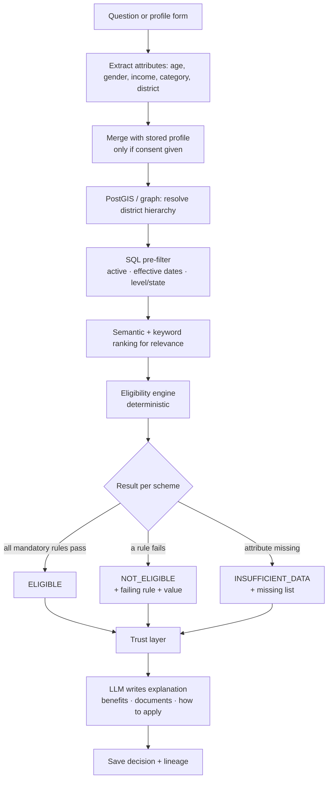

**Eligibility evaluation algorithm**
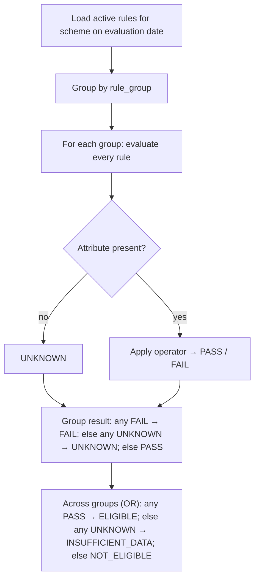

## 6. Service discovery and actionability

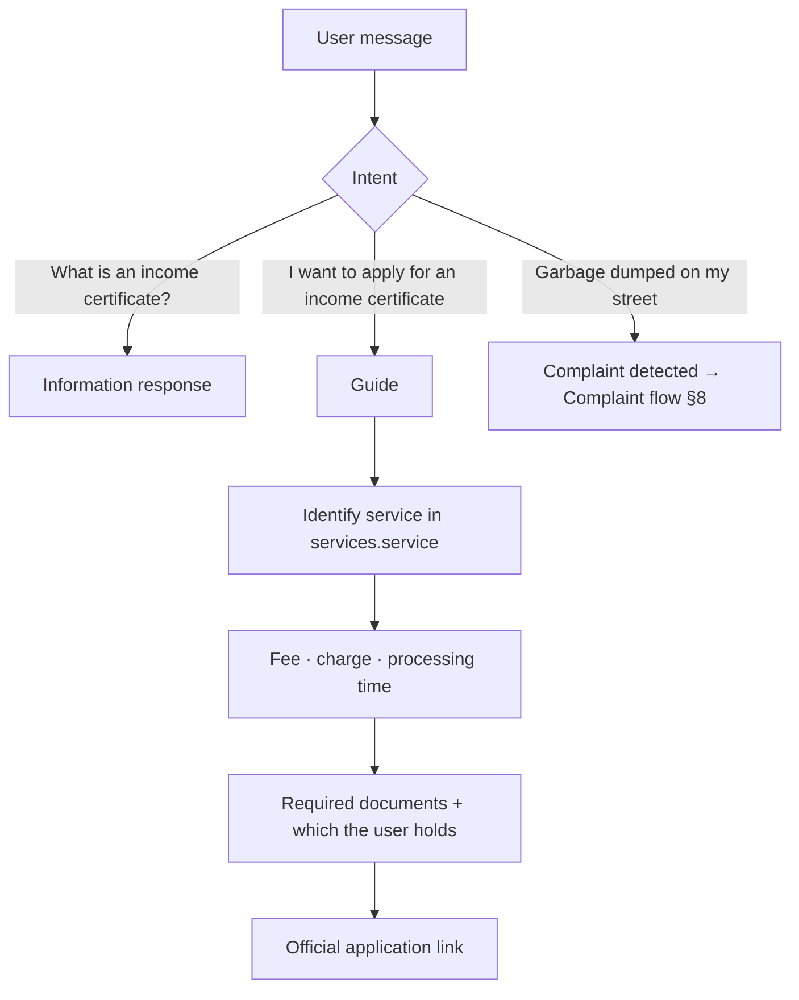

## 7. Document and policy search with policy resolver

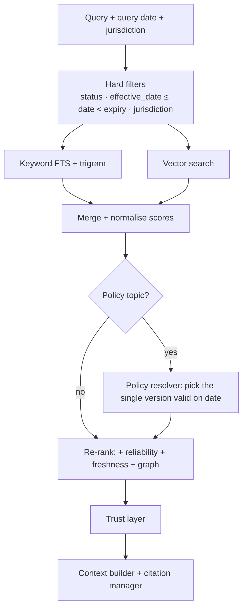

## 8. Complaint lifecycle

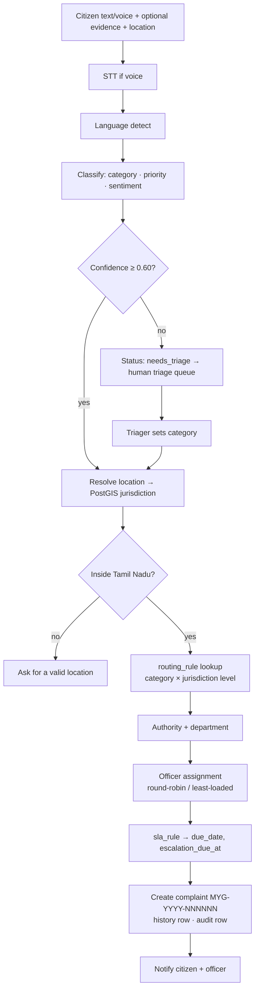

**Status state machine**
```mermaid
stateDiagram-v2
    [*] --> submitted
    submitted --> needs_triage: low confidence
    submitted --> classified
    needs_triage --> classified: triager decision
    classified --> assigned
    assigned --> in_progress: officer accepts
    in_progress --> resolved
    resolved --> closed: citizen confirms / auto-close after N days
    resolved --> reopened: citizen disputes
    reopened --> in_progress
    assigned --> escalated: SLA breach
    in_progress --> escalated: SLA breach
    escalated --> in_progress: higher authority acts
    submitted --> rejected: invalid / duplicate
    closed --> [*]
    rejected --> [*]
```

## 9. SLA monitoring and escalation

```mermaid
sequenceDiagram
    participant SCH as Scheduler (every 5 min)
    participant DB as PostgreSQL
    participant ESC as Escalation service
    participant N as Notifier
    SCH->>DB: SELECT complaints WHERE escalation_due_at < now AND no open escalation
    loop each complaint
        SCH->>ESC: escalate(complaint_id)
        ESC->>DB: BEGIN; lock row (FOR UPDATE SKIP LOCKED)
        ESC->>DB: parent_authority_id of current authority
        alt parent exists
            ESC->>DB: INSERT escalation; UPDATE complaint (authority, status=escalated, new escalation_due_at); history; audit
            ESC->>N: notify parent authority + citizen
        else top of chain
            ESC->>DB: flag "unresolved at top level"; notify state admin
        end
        ESC->>DB: COMMIT
    end
```
Idempotency: the `NOT EXISTS open escalation` check plus row lock means re-runs do nothing twice.

## 10. Jurisdiction resolution

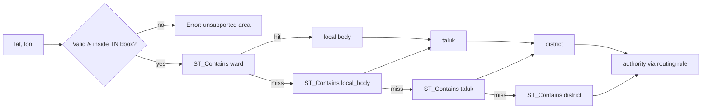
Fallback behaviour: if the finest level is unavailable (no ward polygons), route at the finest resolved level and record that level on the decision.

## 11. Data ingestion (ETL)

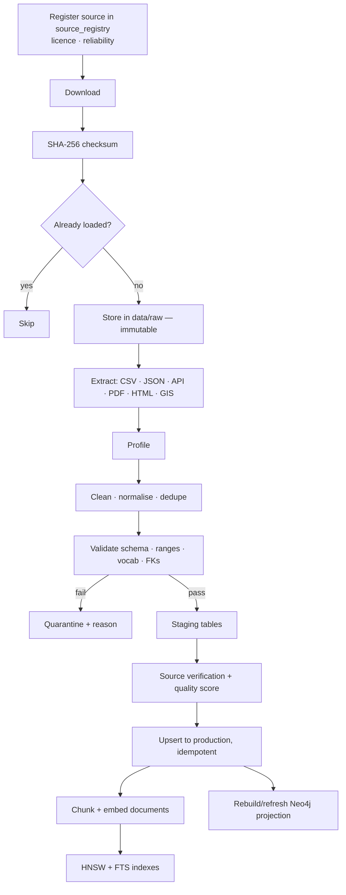

## 12. Knowledge graph build and use

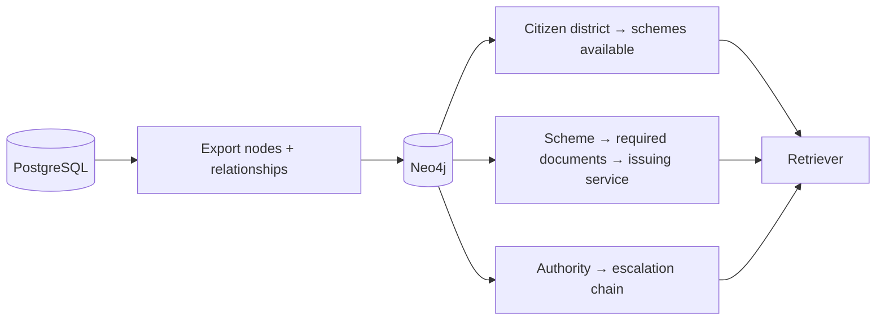

## 13. Authentication and authorisation

```mermaid
sequenceDiagram
    actor U as User
    participant API as FastAPI
    participant DB as PostgreSQL
    U->>API: POST /auth/login
    API->>DB: verify hash, status, lockout
    API-->>U: access JWT (15 min) + refresh token
    U->>API: request + Bearer JWT
    API->>API: verify signature, expiry, role
    API->>DB: BEGIN; SET LOCAL app.role, app.citizen_id
    API->>DB: query (RLS + service-layer jurisdiction filter)
    API->>DB: audit_log insert
    API-->>U: response
```

## 14. Voice flow

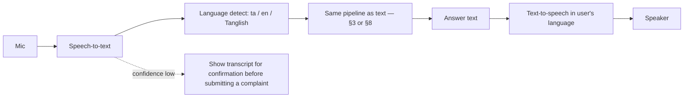

## 15. Officer and admin flows

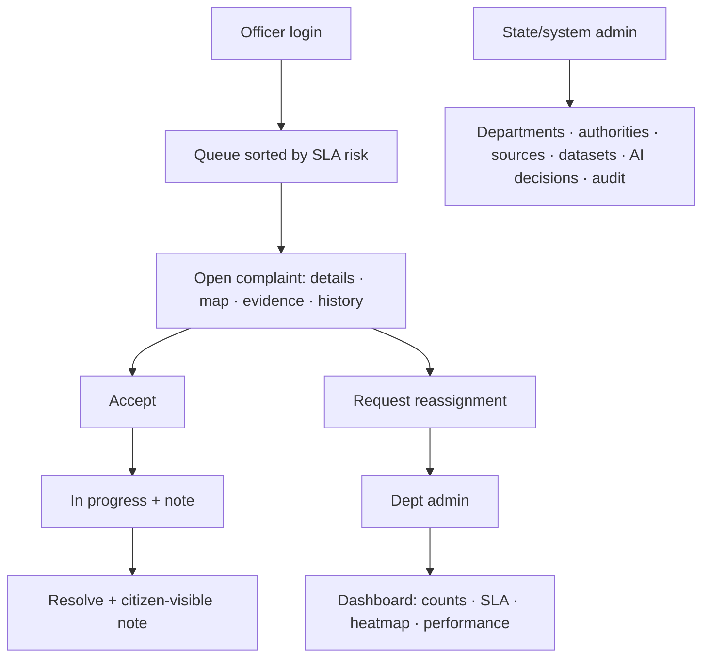

## 16. Deployment topology (local / demo)

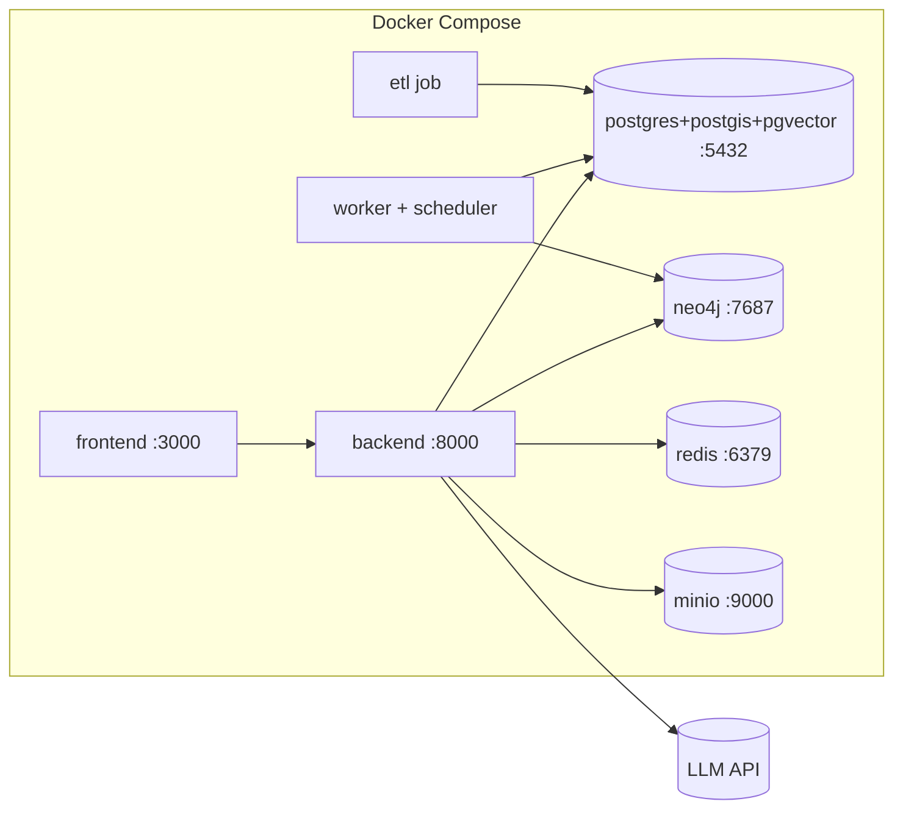

## 17. Error and fallback handling

| Failure | Behaviour |
|---------|-----------|
| LLM down/timeout | Return structured results (schemes/rules/citations) without prose; mark `degraded=true` |
| Neo4j down | Skip graph term; use SQL/vector only |
| Embedding service down | Keyword + SQL only |
| STT low confidence | Ask the user to confirm transcript |
| No coordinates | Ask for map pin/address; allow district-level submission |
| Trust below threshold | Abstain; link to official source |
| Classifier low confidence | Triage queue |
| Duplicate upload | Reject by hash |
